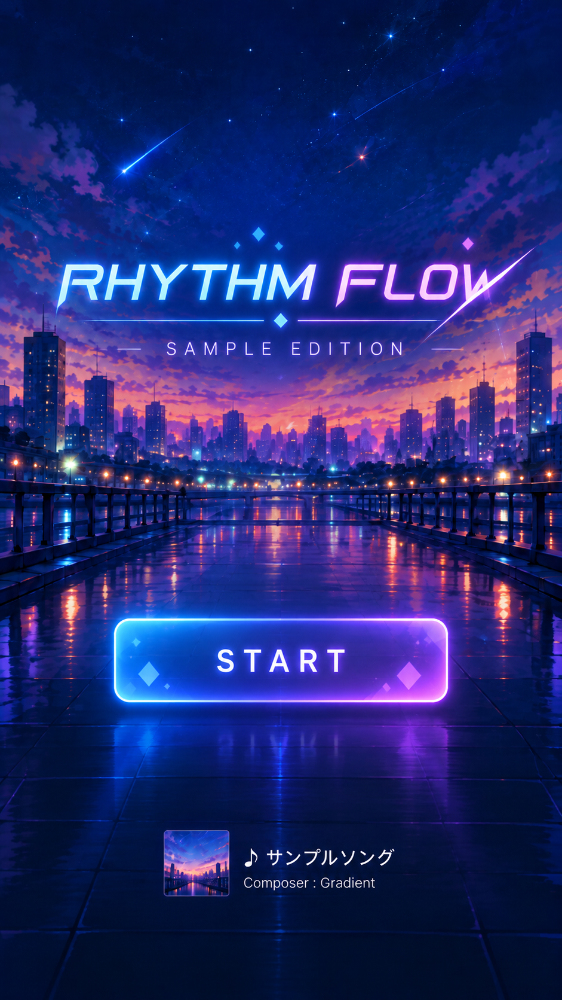

# requirements: title-scene

## 目的
開始画面（Title Scene）を設計・実装し、開始画面からゲーム画面（Play Scene）に遷移できるようにする。

## タスク種別
設計・実装

## 前提
- `docs/proposal.md`（「スコープ」、タスク候補 1「画面の骨組み」）
- `docs/architecture.md`
- `docs/spec/layout.md`

## 画面イメージ


* AI の出力イメージなので細部で変更はある点に注意

## 表示要素
1. 背景画像
   - src/assets/bg.webp（900×1600、9:16。サイズ調整・圧縮済み）
2. タイトルロゴ
   - タイトルは sv-rhythm-demo でOK、イメージ画像の sample edition のような副題は不要
   - Webフォントで一度試してみる
3. スタートボタン
   - 押すとプレイ画面に遷移する。キーボードの SPC でも開始可能にする
   - 「Press SPACE to start 」という説明文（白字）をボタン下部に添える
     - 説明文はキーボードがありそうな環境（PC）でのみ表示し、タッチ端末では表示しない（判別方法はテクニカルノートを参照）
   - ボタンは SVG の要素として作る（HTML の `<button>` は使わない）

- 画面イメージ下部の曲の表示については対応しない

## やること
- 表示内容の実装
- 開始画面の仕様を `docs/spec/title.md` に記載する
- Scene の切り替えの仕様は `docs/architecture.md` に記載する
  - App.svelte にて、svelte のリアクティブ変数で現在の画面を管理する（今の実装通り）

## やらないこと
- ゲーム画面（Play Scene）の中身の実装
- タイトルロゴはイメージでは svg などで描画する必要があるが今回は対応しない（将来的に余裕があればやるかもくらい）
- 遊び方ボタン（導入した方が良さそうだが画面の追加なので後から対応する。レイアウトも後で調整する）
- 音声再生のためのユーザ操作による制限の解除（スタートボタンの操作を音声の解錠に使うかは、音声を扱うタスクで検討する）


## テクニカルノート
### 説明文の表示判定（PC とスマホの判別）
- 端末の種類ではなく入力手段で判別する。ライブラリや JS は使わず、CSS のメディアクエリで行う
- マウスなど精密なポインタがあり、ホバーできる環境（≒ PC）でのみ表示する

```css
.hint { display: none; }
@media (hover: hover) and (pointer: fine) {
  .hint { display: block; }
}
```

- 完全な判別ではないが、以下の挙動を許容する
  - タッチ対応のノート PC: 主な入力がマウス・トラックパッドと判定され表示される（キーボードがあるので問題ない）
  - キーボードを接続した iPad: 非表示になる（Space での開始は可能）
