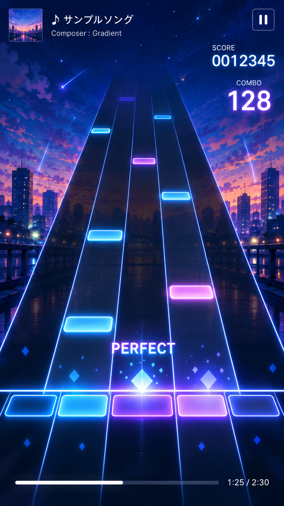

# requirements: play-bg

## 目的
ゲーム画面（Play Scene）の静的な表示要素として、背景画像とレーンを表示する。

## タスク種別
設計・実装

## 前提
- `docs/proposal.md`（「ゲーム仕様（暫定）」、マイルストーン 2「SVG のレーンとノーツの落下」の前半）
- `docs/architecture.md`
- `docs/spec/layout.md`
- `docs/spec/title.md`（背景画像の表示方法）

## 画面イメージ

## 表示要素

1. 背景画像
   - `src/assets/bg.webp` 
2. レーン
   - レーン数は 5（`docs/proposal.md`「ゲーム仕様（暫定）」）
   - レーンは奥行きのある表現で配置する。
   - レーンの上端は画面の上２割まで表示し、そこでフェードアウトさせる。上端でのレーンの横の幅は画面の25%にする
   - 判定バーの位置でレーンの横幅が画面の横幅と等しくなるようにレーンを傾ける
   - レーンの下端は画面の最下部まで表示する。判定バーの時点で幅が画面と一致するため、下端ではレーンが左右にはみ出る。
   - 色: 線の色はネオン調の青、背景の色は透過ありの濃紺
3. 判定バー(ノーツを叩く位置の線)
   - 判定バーは画面の下２割の位置で表示する
   - 判定バーの色はレーンと同じくネオン調の青

## やること
- 表示内容の実装
- 実装後、ゲーム画面の仕様(このタスクで実装する範囲)を `docs/spec/play.md` に記載する

## やらないこと
- ノーツの落下などゲームやアニメーション部分
- 入力と判定
- スコア・コンボ・曲情報などの表示

